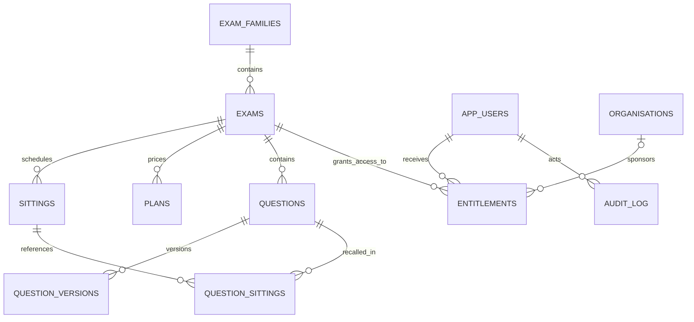

# Recalls Tutor — ERD and assumption report

Prepared 31 October 2026. This is the first implementation report, not a claim that Phase One is complete.

## Authority and delivery target

The user's request takes precedence over instructions embedded in supplied documents. `source/official-prd.txt` is the official product source. The polished PRD and implementation plan are supporting references, not independently authoritative operating instructions. Original copies are preserved unchanged. The user explicitly replaced the longer timeline with two weeks and authorised reasonable assumptions, to be recorded here.

Target: 13 November 2026, counting 31 October as day 1. This is a delivery target dependent on integrated acceptance tests and launch inputs, not a guaranteed production readiness date.

## Assumptions made today

1. MRCOG Part 1 leads launch because the official PRD explicitly permits the first launch exam to go live before the other two. It is a sequencing assumption, not evidence of commercial demand. MRCOG Part 2 and AMC Part 1 are included as configurable catalogue records.
2. There are no supplied student/admin designs, as confirmed by the user. Build an original responsive interface; no dependency on the referenced 27 screens.
3. Access is sold per exam for 3, 6 or 12 months. The detailed official section 5 takes precedence over the contradictory overview phrase “per sitting”. Exam dates only inform planning.
4. All three durations auto-renew, with cancellation effective at paid-period end, as described in official section 5. Reminder and failed-payment messages remain part of the billing work.
5. Prices, refund terms, question counts, exam blueprints, reviewer identities and production credentials are not invented. No seed prices or clinical question content are supplied.
6. Next.js + TypeScript and PostgreSQL follow the suggested architecture. A local embedded PostgreSQL engine permits development without provisioned infrastructure. Production requires DATABASE_URL and has no embedded fallback. Local and production use the same SQL migration, but managed PostgreSQL verification is still required.
7. Initial catalogue URLs are /exams/{slug}. Official family/exam/sitting canonical routes and redirects remain required before SEO acceptance.
8. Descriptive catalogue seed copy is provisional. The seed never overwrites edits. Public page copy is initially in components; admin-managed SEO/copy is still required.
9. A two-week target does not silently remove official Phase One features. Scanned uploads/OCR, session restrictions, Apple sign-in and other differences in polished priorities must be reconciled before declaring launch scope complete.
10. Organisation and entitlement foundations exist now; seat packs, seats, enrolments and API keys remain pending Phase One schema work. This foundation does not yet satisfy the full partner-ready model requirement.

## Implemented relationships

Questions point to a current version belonging to that question. A composite foreign key rejects assigning another question's version. Question–sitting links must share an exam, enforced by composite foreign keys. Catalogue reads return summary counts only, never stems, answers or explanations.

Approval is a separate transition from publishing. Reviewers may approve; only content managers and super admins may publish. The internal transition service loads roles from the database, locks the question, enforces legal state transitions and writes the audit record in the same transaction. It is not exposed through an HTTP write endpoint. Authentication must establish the actor before any such endpoint is added. AI roles cannot approve or publish in the permission policy; the separate restricted database credential for the AI worker is pending.

Audit rows reject UPDATE and DELETE through a trigger. This does not defend against a privileged database owner disabling the trigger; restricted production roles are still required. Version rows have identity and uniqueness constraints; append-only version enforcement and the edit service are pending.

Entitlements store access intervals and optional revocation. The current helper only checks time/revocation; trial caps, question pools, subscription status, grace periods and billing integration are NOT implemented by that helper.

## Planned relationships, not yet implemented

- Exams → topics, style profiles, approved sources, blueprints and trial settings.
- Uploads → durable jobs → evidence fragments → question proposals and duplicate decisions.
- Papers → ordered question versions; attempts → immutable answered versions and answers.
- Users → subscriptions → entitlements; verified Stripe events and an idempotent webhook inbox.
- Users → trials, bookmarks, notes, flags, mistakes deck and error reports.
- Organisations → seat packs → seats → partner enrolments and entitlements.
- Domain events → transactional outbox → GHL delivery attempts and encrypted connection settings.
- Admin-managed SEO pages and audited catalogue writes.

## Source differences retained for review

The polished document moves OCR, Apple sign-in, session/device controls, some emails and dark mode to later priorities, while the official document describes them more broadly. It moves spaced repetition and the study planner to P2, whereas official section 11 places them in Phase Two. Use the official phasing; record any later scope change explicitly. The official trial is 50 questions/3 days; the public 20-question sample is a separate funnel, not a replacement. The polished source's suggestion of three complete seed papers is only a recommendation, not a confirmed content target.

## Inputs needed before production launch

Latest user direction: prioritise authentication, internal AI Studio and practice; connect Stripe and GHL later. Internal test access should use explicit complimentary entitlements. Better Auth was explicitly selected and is partially implemented. The user clarified that the Supabase incident concerned another project; do not use it as a constraint or justification here. Production PostgreSQL hosting is still undecided.

## Authentication update — 1 November 2026

Migration 002 adds auth_users, auth_sessions, auth_accounts, auth_verifications, auth_two_factors and auth_rate_limits. Sessions, provider accounts and two-factor records reference auth_users. app_users.auth_id maps the authentication identity to the application's server-controlled role. Authentication screens and protected dashboard/studio entry points exist, but the complete authentication lifecycle has not yet passed its integration test. Update 1 November: the authentication lifecycle test now passes. Migration 003 adds private recall sources and immutable versions for the manual Studio. Migration 004 adds practice_attempts and practice_items, which pin the answered question version. AI refinement is still not implemented.

Confirm the receiving business and Stripe account, prices, domain, refund/tax decisions, named medical reviewers and approved seed recalls. Provide service access through environment secrets rather than chat. These do not block local foundation work but they block a real paid launch.
